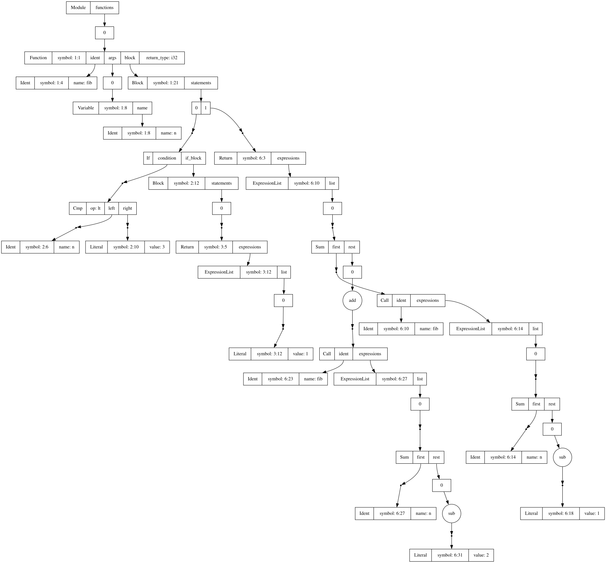

# RJ - work in progress programming language

Are you too smart for [golang](https://go.dev/), but too dumb for [rust](https://www.rust-lang.org/)?

Fear not, you are not alone!

RJ to the rescue - *The brand new hipster language no one asked for*
## Language

```
// Functions can return several values.
fn min_max(a: [i32; 4]): i32, i32 {
  lo: i32
  hi: i32
  i: i32
  lo, hi, i = a[0], a[0], 1

  while i < 4 {
    if a[i] < lo {
      lo = a[i]
    }
    if a[i] > hi {
      hi = a[i]
    }
    i = i + 1
  }

  return lo, hi
}
```

- Types: `i32`, `bool`, fixed-size arrays `[T; N]` of any type, and structs:
  ```
  struct Node { value: i32, edges: [i32; 4] }
  n = Node(value: 1, edges: [0; 4])   // named fields, in any order
  ```
- Everything is a value: assigning, passing or returning an array or struct
  copies it, and a function changing its parameter never affects the caller.
- Inside a function, variables are mutable: assignment (including parallel
  `a, b = b, a`), assignment to parts such as `g.nodes[i].value = v`,
  `if`/`else` and `while`.
- Variables must be assigned before they are read; array indexes are bounds
  checked (at compile time for constants, otherwise at run time).


The compiler is a single crate, `projects/rjc`, with one module per stage.

### Parser and AST (`src/syntax`)

`rj.pest` holds the grammar, `parser.rs` turns pest's parse tree into the AST in
`ast.rs`. The AST is a plain owned tree where every node carries the byte span it
was parsed from, so later stages can report errors at the right place.

You can print the AST by running:
```sh
cargo run -- <FILE> --emit-ast
```

To output a graph in dot language you can run:
```sh
cargo run -- <FILE> --emit-ast-graph
```

Here is an example on the following code:
```
fn fib(n: i32): i32 {
  if n < 3 {
    return 1
  }

  return fib(n - 1) + fib(n - 2)
}
```

`cargo run -- test.rj --emit-ast-graph | dot -Tsvg > images/fib-ast.svg`:



### Resolver and type checker (`src/check.rs`)

Resolves names and checks types, producing the program in `src/hir.rs`: variables
become indices into each function's table of locals, calls point directly at the
function they call, and every expression carries its type.

It also checks that every variable is assigned before it is read, that functions
return a value on every path, and that `fn main(): i32` exists. All errors are
reported, not just the first. To print the result:
```sh
cargo run -- <FILE> --emit-hir
```

### RJ IR (`src/ir`)

Lowers the checked program into a control-flow graph of basic blocks over a flat
table of locals. Parameters, return values, variables and temporaries are all
locals, statements only ever write whole locals, and a call reads all its
arguments before writing its results, so `x = f(x)` becomes `call f(x) -> [x]`.

To print it:
```sh
cargo run -- <FILE> --emit-ir
```

A small interpreter (used by the tests) runs the IR directly, so lowering is
checked against every program in `test/` without needing LLVM.

### Parameter modes (`src/ir/modes.rs`, `src/ir/liveness.rs`)

Arrays are values, but copying them is expensive. Each function's array
parameters are classified from its own body (`--emit-ir` shows the result):

- **in/out**: every `return` hands back the parameter itself in the same slot.
  The parameter shares storage with that return value, so `x = f(x)` passes
  `x`'s own buffer and nothing is copied.
- **read**: never written, so callers lend their array instead of copying it.
- **consume**: written but not returned. The caller hands over its own array
  when liveness shows it no longer needs it, and passes a copy otherwise.

This also works on parts of variables: `g.nodes[i] = bump(g.nodes[i])`
passes a pointer straight into `g`, and `sum(g.nodes[i].edges)` with a
read-only parameter reads the edges where they are.

A copy is only made when the caller still needs the old value or the same
storage would otherwise be visible twice in one call. For parts, "the same
storage" is judged per variable: two different elements of `g` used in one
call are treated as overlapping. `test/array_alias.rj`
covers those cases, and codegen tests count the copies emitted for the common
patterns.

### LLVM Generator (`src/codegen.rs`)

Emits textual LLVM IR from the RJ IR. Every function returns `void` and takes one
pointer per return value followed by its arguments by value; a call passes the
destination variables' storage as those pointers. Functions are emitted as
`rj_<name>`.

`stdlib/start.ll` provides `_start`, which calls `main` and exits with its return
value using the Linux x86-64 `exit_group` syscall, so programs need neither libc
nor a dynamic linker.

## Testing

```sh
cargo test   # unit tests, plus every program in test/ through the IR interpreter
             # and, if llc and ld.lld are installed, compiled to native code
make test    # compiles each test/*.rj with llc + ld.lld and runs it
```

Each program in `test/` passes by exiting with 0.
